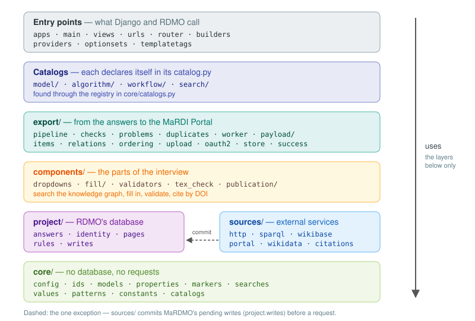

# Architecture

MaRDMO is a Django app that plugs into RDMO: RDMO calls it when an answer is
saved, when a dropdown needs options, and when a project is exported.  Its
code is arranged in layers; each layer uses only the layers below it.

## Layers

| Layer | Holds | Uses |
|---|---|---|
| **Entry points** (top level) | What Django and RDMO call: the app (`apps`), the export provider and its pages (`main`, `views`, `urls`), the signals of saved answers (`router`, with the handlers and validators by question from `builders`), the option set provider (`providers`, with the setting in `optionsets`), the template tags | everything below |
| **Catalogs** (`model/`, `algorithm/`, `workflow/`, `search/`) | One package per catalog: its declaration (`catalog.py`), handlers, checks, the preparation of its export (`worker.py`), its data | `export/` and below |
| **`export/`** | The way from the answers to the MaRDI Portal: the checks and the preview (`pipeline`, `checks`, `problems`, `duplicates`), the payload, the upload with the OAuth flow, the new IDs written back (`items`), the result page | `components/` and below |
| **`components/`** | The parts of the interview, which do not depend on a catalog: the dropdown search of the knowledge graph (`dropdowns`), filling in a selected item (`fill/`), the validators, the LaTeX check, the publications by DOI (`publication/`) | `project/`, `sources/`, `core/` |
| **`project/`** | MaRDMO's reading and writing of a project's answers in RDMO's database: the answers as a dict (`answers`), the item IDs while a project is answered (`identity`), the tabs (`pages`), the batched writes (`writes`) | `core/` |
| **`sources/`** | Every request to an external service: one session with retries and time limits (`http`), SPARQL (`sparql`), the Wikibase API (`wikibase`), the MaRDI Portal, Wikidata and the citation services | `core/`, and `project.writes` (see below) |
| **`core/`** | What every layer needs: MaRDMO's configuration and vocabulary (`config`, `properties`, `markers`, `searches`), the rules of the item IDs (`ids`), the data classes (`models`), the catalog registry (`catalogs`) | nothing else of MaRDMO; no database, no requests |

RDMO's models are used where the answers are read or written, not only in
`project/`: the handlers of the catalogs and components write the answers of
an item they fill in, the export writes the new IDs back.  `project/` holds
what MaRDMO itself adds to RDMO's database: how the answers become a dict,
how the item IDs stay right, and when MaRDMO's writes are committed.

**The one exception.**  MaRDMO collects its own writes of answers in one
transaction (`project.writes.batched_writes`).  A request to an external
service can take up to 30 seconds, and an open transaction would lock the
database for that long, so `sources/` commits the pending writes before every
request (`commit_writes`).  Strictly, the caller would commit; the requests
start from some twenty places in eight modules, and any new one that forgot
would lock the database again.

## How the Parts Fit

**Catalogs as plugins.**  Each catalog declares itself in its `catalog.py`:
its catalogs and questions, its handlers, relations and validators by
question, the class that prepares its export and the class that checks it.
`core/catalogs.py` finds the catalog packages by name (`CATALOG_PACKAGES`);
the rest of MaRDMO knows them only through this registry.  The one direct use
is the search, which `main` calls for its preview.  Adding a catalog is a new
package and its name in the registry (see
[How to add a catalog](../how-to/rdmo/add-catalog.md#in-mardmo)).

**Tables instead of code.**  Which handler and which validators a question
has (`builders`, from the declarations), which search a dropdown runs (one row
per provider key in `core/searches.py`), and which answer goes where
(`data/questions.json` of each catalog) are tables; a new question is a row,
not a new class.

**The export as a pipeline.**  The preview and the export run the same steps
one after another — the checks, the duplicates on the portal, the payload,
the upload, the new IDs written back — and each step hands its result to the
next (see [Export Pipeline](export.md)).

**One way to the outside.**  Every request goes through `sources/` and its
session (`sources.http.http_session`), so retries and time limits are the
same everywhere, and the tests can answer the requests from recorded answers
of the services (only the live tests ask the services themselves).

## Where Something New Goes

| A new … | Goes to |
|---|---|
| catalog | a package of its own with a `catalog.py`, and its name in `core/catalogs.py` |
| question of a catalog | its row in the catalog's `data/questions.json` and its declaration (see [Add a Question](../how-to/mardmo/register-question.md)) |
| check of a field | `components/validators.py` (see [Validate a New Field](../how-to/mardmo/validate-field.md)) |
| check before the export | the catalog's `checks.py`, or `export/checks.py` if every catalog needs it |
| external service | a module in `sources/` |
| part of the interview that other templates could use | `components/` |
